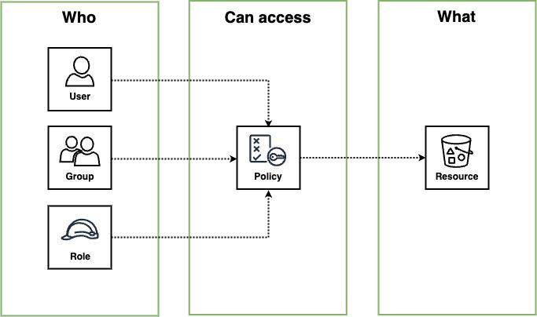

# AWS IAM (Identity and Access Management)

## Overview

IAM stands for **Identity and Access Management**. In simple words, IAM controls **who** can access your AWS account and **what** they are allowed to do.

Consider an AWS account with the following services:

- **EC2** — your server
- **S3** — file storage
- **RDS** — database

And three people who need access:

| Person | Permission |
|---|---|
| You (Owner) | Full access |
| Developer | Access to EC2 only |
| Accountant | View billing only |

IAM lets you define exactly these permissions:



## Core Concepts

- **IAM Users** — Who is accessing AWS?
- **IAM Groups** — Which team does the user belong to?
- **IAM Roles** — What can they do?
- **IAM Policies** — What temporary permissions can an identity assume?

### Common Roles

| Role | Purpose |
|---|---|
| `AccountFullAccessRole` | Provides full account access to a trusted entity |
| `AWSManagedAccountManagementAccessRole` | Supports AWS account management |
| `AWSServiceRoleFor...` | Allows specific AWS services to perform their required operations |

Roles starting with `AWSServiceRoleFor` are generally **service-linked roles**. AWS creates these automatically so its services can operate on your behalf.

## Policies

A policy is a permission document attached to an identity.

### Example: EC2ReadOnlyPolicy

```text
EC2ReadOnlyPolicy
       |
       | Allows
       v
View EC2 instances
View instance details
View security groups
       |
       v
Cannot create or delete instances
```

### Policy JSON

```json
{
    "Version": "2012-10-17",
    "Statement": [
        {
            "Effect": "Allow",
            "Action": [
                "ec2:DescribeInstances",
                "ec2:DescribeImages",
                "ec2:DescribeSecurityGroups",
                "ec2:DescribeVolumes"
            ],
            "Resource": "*"
        }
    ]
}
```

### JSON Property Reference

| JSON property | Meaning |
|---|---|
| `Version` | IAM policy language version |
| `Statement` | Contains permission rules |
| `Effect` | `Allow` or `Deny` |
| `Action` | Which AWS operations are permitted |
| `Resource` | Which resources the rule applies to |

For example:

```json
"Action": "ec2:DescribeInstances"
```

This allows the user to view (describe) EC2 instances.

> **Important:** AWS uses **default deny**. If an action isn't allowed by an applicable policy, it is denied — unless another applicable policy grants it.
